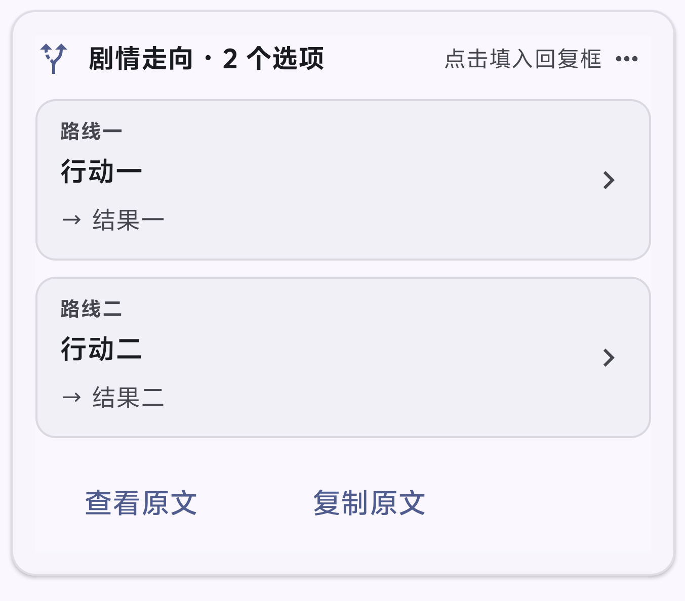

# RP 标签渲染器

Operit ToolPkg 插件：标签块渲染、标签内正则替换，以及只注入 JS 返回文本的动态提示词功能。

- 版本：**2.3.2**
- 插件 ID：`com.operit.rp_xml_renderer`
- 源代码：[liqiming-whu/rp-xml-renderer](https://github.com/liqiming-whu/rp-xml-renderer)
- 安装包：[GitHub Releases](https://github.com/liqiming-whu/rp-xml-renderer/releases)
- 许可证尚未选择；公开可见不等于已授予开源许可证。

## 功能

| 模块 | 能力 | 边界 |
|---|---|---|
| 标签渲染 | 折叠面板、卡片、Markdown、选项、隐藏；经典紧凑外观与自定义样式 | 仅处理已登记标签，完整块/角色归属验证失败保留安全原文 |
| 正则替换 | 每条标签规则独立配置、按顺序替换、预览、捕获组模板 | **不是整条 AI 回复的全局替换**，不改写历史原文 |
| 动态 JS | 随机码、时间、自定义、每日主题＋微事件，共四套独立脚本 | 同一时刻只启用选中的一套，不是四套自动叠加 |
| 角色范围 | 指定角色或全部角色（含未来新增） | 默认不启用动态注入，也不自动绑定角色 |
| 时间与诊断 | 跟随设备/自定义时区、语法检查、试运行、错误码 | 试运行不保存、不向模型发送请求 |

## 实机示例

用户已确认 v2.3.1 实机测试通过。以下为用户提供的实机界面示例；具体颜色随宿主主题而变化。

### 剧情走向 · 选项卡片

双选项示例：每项展示路线、行动与结果，并提供点击填入回复框的入口。截图中原文工具栏处于展开状态。

### 剧情构建过程 · 折叠面板

展开状态示例：标题显示正文行数，正文保留 Markdown 样式，右上角可收起面板。

## 快速开始

**首次安装：标签规则默认不绑定任何角色。**先在“标签渲染配置 → 编辑规则”中选择角色，保存并应用设置；不要把安全回退误认为插件未安装。升级已有已保存配置时不重置角色绑定或脚本。动态 JS 是独立开关，默认关闭。

1. 在 Operit 导入/更新 `com.operit.rp_xml_renderer-v2.3.2.toolpkg`。
2. 插件详情 → **标签渲染配置** → **动态 JS 注入 · 四套预设**。
3. 选预设与角色范围，设置时区，检查语法并试运行。
4. 确认返回内容后，打开正式注入开关，点击保存。
5. 下次匹配的主角色对话请求才生效；不自动给旧消息追加注入。

**新预设**：默认七个主题按所选时区的日期轮换；同一天主题不变。每次新请求独立有 15% 概率附带可选微事件，可修改 `themes`、`events`、`eventChance`。没有每日次数记录，不保证一天只发生一次，也不能自动读聊天判断事件是否已经发生。

JS 必须 `return` 字符串。脚本的空格、换行原样保留，不加 XML、标题、编号或解释；`return "";` 表示本轮不注入。新预设中的“今日主题”等字样由默认 JS 自己生成，可以自由删除。

## 文档与示例

- [玩法与使用指南](docs/GUIDE.md)：七类玩法、操作路径、时区、错误与常见误区。
- [图标与主题颜色](docs/APPEARANCE.md)：可填名称、完整颜色白名单、配色示例与官方链接。
- [开发与维护](docs/DEVELOPMENT.md)：构建依赖、测试、目录、安装、回滚与 Git 工作流。
- [Bug 与决策记录](docs/BUGS.md)：首次导航卡加载的复现、根因和修复证据。
- [v2.3.2 发布记录](RELEASE-v2.3.2.md)：测试及安装状态。
- [可复制 JS 示例](examples/)：复制文件内容到脚本编辑框即可，无需 import。

## JS 执行范围

提供 `randomCodes()`、`now()`、`context.time` 和 324 字符的 `DEFAULT_CHARSET`；支持当前 QuickJS 的标准语言功能、函数、数组、循环、Promise/await。不是浏览器或 Node.js 环境，不保证实现所有未来 ECMAScript 特性。

不开放 Java、Tools、文件、网络、Node.js、DOM、Intl、定时器；脚本不能读聊天、不能读写持久化变量。脚本每次独立执行；携带本插件请求标记的同请求重复组装复用结果。

限制：源码 32768、输出 16384 个 UTF-16 码元，执行阶段时限 1500ms，最多两个执行槽位。独立 JS 上下文仍在应用进程内，**没有硬内存配额，请只运行可信脚本**。报错时不把错误或脚本源码注入给模型。

动态文本是模型提示，不是确定性的剧情引擎；骰子结果不能保证模型严格遵守，随机码也不等于模型随机种子。

## 构建概览

依赖 Python 3、Node.js、TypeScript 5.9.3、JDK 17 与 Google R8 8.3.37。将 R8 放入 `build-tools/r8-8.3.37.jar` 后，在仓库根执行 `python3 build.py`。具体下载地址、校验值和验证步骤见开发文档。

项目不再依赖仓库外的 `../types`。构建先编译 DEX 与 TypeScript，再运行全部本地测试，最后生成 `.toolpkg`。本地测试不等于实际手机视觉验收；宿主探针也不向真实模型发送消息。

## 兼容与回滚
- v2.3.2 是公开分发版：移除源码/安装包中的个人默认绑定；不改写已保存的用户配置。

- v2.2 的 JSON 指令内存迁移为等价 JS，保留开关、角色和 revision。
- v2.3 的三套 JS 配置只补入缺失的第四套脚本，不覆盖已有脚本或选择；首次保存才持久化。
- 旧版本可能不识别第四套预设。若升级后已保存新配置，不应只降级包文件；先备份当前配置，再按开发文档回滚相配套配置。
- 新增标签仍可能需要手动重启 Operit；已有 UI 缓存先退出配置页后重新进入。

此插件不修改世界书插件，不实现 `set_var` 或酒馆宏解释器。